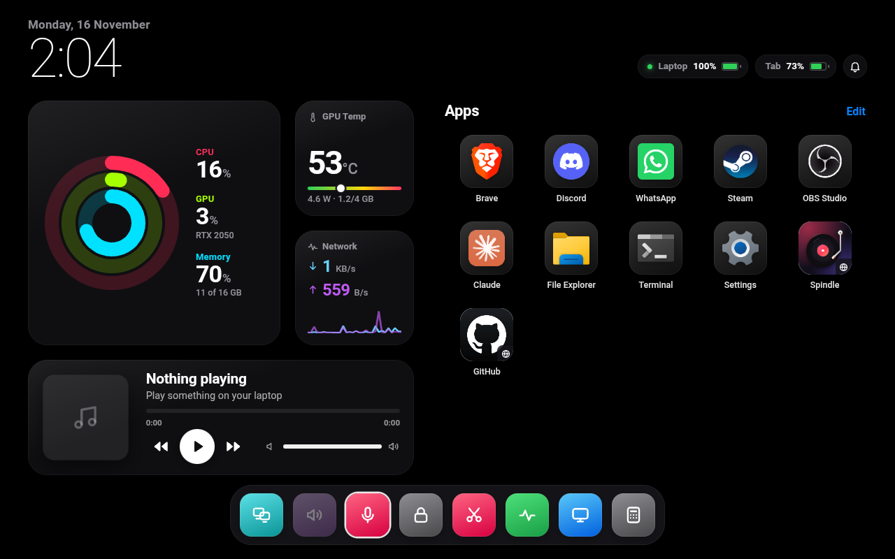
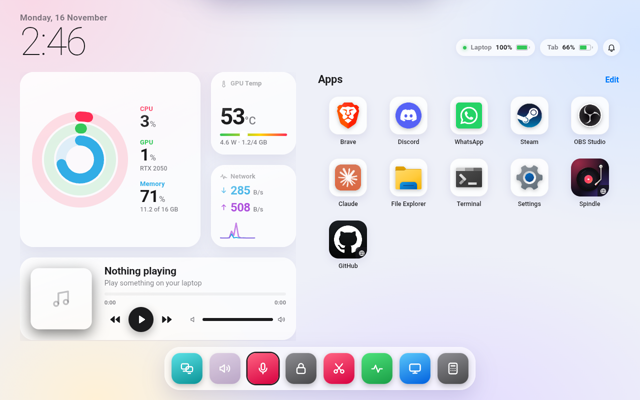
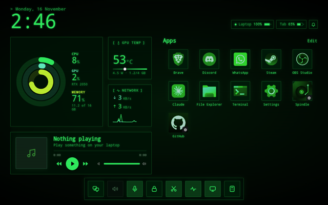
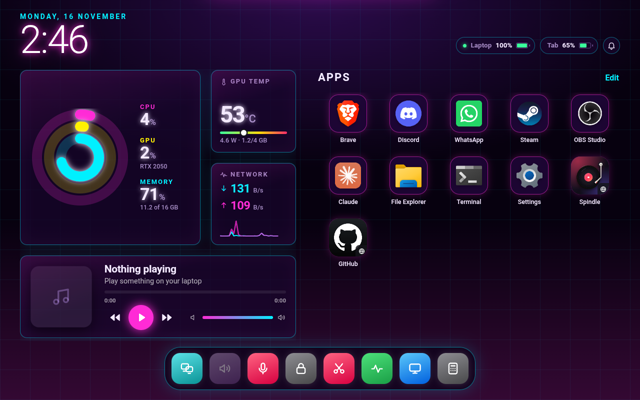

# TabDeck

**Turn an old Android tablet into a touch command center for your Windows PC**: live stats, an app launcher, a
low-latency second screen with touch, the tablet's mic and speakers, Now Playing, and Allow / Deny buttons for
Claude Code. All over one USB cable, no Wi-Fi, and it starts by itself when you log in.



## Features

| | |
|---|---|
| **Dashboard** | Activity rings for CPU / GPU / RAM, GPU temperature, network, laptop + tablet battery, clock. 8 wallpapers, accent colours. |
| **App launcher** | Your PC apps (with their real icons) and websites. Tap to open on the PC. Long-press to edit, like an iPad. |
| **Now Playing** | Song, artist, artwork, draggable seek bar and volume bar for whatever is playing (Spotify, YouTube, browser tabs…). |
| **Second screen** | The tablet becomes a real extended monitor with multi-touch. GPU capture + hardware H.264, ~20 ms on screen at 45 fps over USB. |
| **Tablet mic** | Use the tablet's microphone as a Windows mic (Discord, Meet, OBS). |
| **Tablet speaker** | Play the PC's sound on the tablet's speakers, optionally muting the laptop meanwhile. |
| **Claude Code** | Chime + banner when Claude finishes; **Allow / Deny** permission prompts on the tablet. |
| **Discord** | Mute / deafen buttons that appear only while Discord is running. |
| **Night clock** | PC off or asleep → the tablet shows a dim, burn-in-safe clock and wakes up with the PC. |
| **Desktop app** | Customise everything (apps, widgets, dock, look, sound, brightness…) with a live preview of the tablet. |
| **Themes** | Restyle the whole tablet with one CSS file. 5 built in (Daylight, Terminal, Neon, Paper, Frosted), upload your own. See [THEMING.md](THEMING.md). |
| **History graphs** | CPU / GPU / RAM over the last 5 or 30 minutes. |

### Themes
| Daylight | Terminal | Neon |
|---|---|---|
|  |  |  |

Make your own in minutes: [THEMING.md](THEMING.md). Share it with a pull request.

**Light on your PC:** the background server is one Python process using about 8 MB of RAM and ~0.01 % CPU.
Second screen, mic and speaker only run while they're switched on.

## Requirements

- Windows 10 / 11 and **Python 3.10+**
- An Android **11+** tablet with a USB cable (built and tested on a Lenovo Tab M10 HD Gen 2, 1280×800)
- For second screen: **ffmpeg** (the installer can get it); an NVIDIA or AMD GPU is recommended (CPU fallback works but uses more power)

## Install

1. On the tablet: **Settings › About tablet** → tap **Build number** 7 times → **Developer options** → turn on
   **USB debugging** and **Stay awake**.
2. Download this repo (green **Code** button → *Download ZIP*) and unzip it.
3. Right-click `install.ps1` → **Run with PowerShell** (or `powershell -ExecutionPolicy Bypass -File install.ps1`).
4. Plug in the tablet and tap **Allow** on the USB debugging prompt.

The installer downloads Google's `adb`, installs the Python packages and the tablet app, and creates a **TabDeck**
shortcut plus auto-start. It *asks* before anything optional (ffmpeg, mic support, Claude Code hooks, home-screen mode).

### Optional extras
- **Real extended monitor:** install the [Parsec Virtual Display Driver](https://builds.parsec.app/vdd/parsec-vdd-0.45.0.0.exe)
  (signed by Parsec). Without it, second-screen mode mirrors your main screen.
- **Tablet as a Windows mic:** [VB-CABLE](https://vb-audio.com/Cable/) (free).
- **Discord buttons:** in Discord › Settings › Keybinds set *Toggle Mute* = `Ctrl+Shift+Alt+M` and *Toggle Deafen* = `Ctrl+Shift+Alt+D`.
- **Debloat a Lenovo tablet:** `tablet-app\debloat.ps1` (reversible; review the list first, it's tuned for Lenovo).

## How it works

```
 Windows PC                                   USB (adb reverse)              Android tablet
 ─────────────────────────────────────────    ─────────────────              ──────────────────────
 server.py  stats · apps · notifications  ──  tcp 8765  HTTP + live events ─ TabDeck app (WebView dashboard)
 display.py Parsec VDD → ffmpeg ddagrab →     tcp 8766  H.264 + touches  ─── MediaCodec decoder + touch
            h264_nvenc/amf, touch injection
 audio.py   WASAPI loopback (raw PCM)     ──  tcp 8767  ──────────────────── AudioTrack (low latency)
 scrcpy     tablet mic → VB-CABLE         ──  adb ──────────────────────────
```

- **Server:** `command-center/` (Python stdlib + psutil). See [command-center/README.md](command-center/README.md).
- **Tablet app:** `tablet-app/` (plain Java, ~60 KB, no Gradle). Build: `tablet-app\build.ps1 -Install`
  (needs a JDK 17+ and the Android SDK build-tools; most people just use the APK from Releases).

## FAQ

**Does it use the internet / Wi-Fi?** No. Everything goes over the USB cable. (Adding a *website* to the launcher
fetches its icon once.)

**My tablet isn't a Lenovo.** It should work on any Android 11+ tablet; second screen uses the tablet's real resolution.
Please open an issue with your model if something's off.

**Previous / next don't work for my music.** The playing app has to support them. Web players need
`navigator.mediaSession.setActionHandler('nexttrack' / 'previoustrack', …)`. TabDeck dims the buttons if the app doesn't.

## License

[MIT](LICENSE) © 2026 Somesh Thakur. TabDeck downloads but does not include adb, scrcpy, ffmpeg, the Parsec driver or VB-CABLE;
those keep their own licenses.
