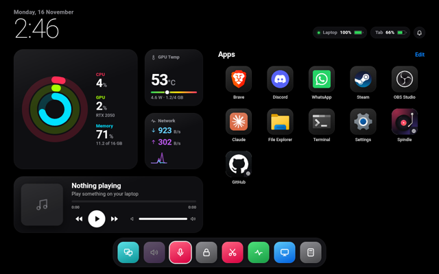
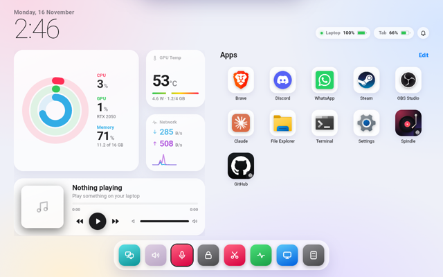
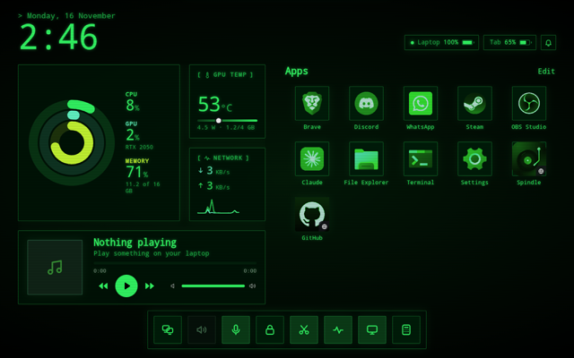
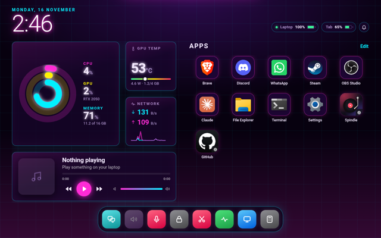
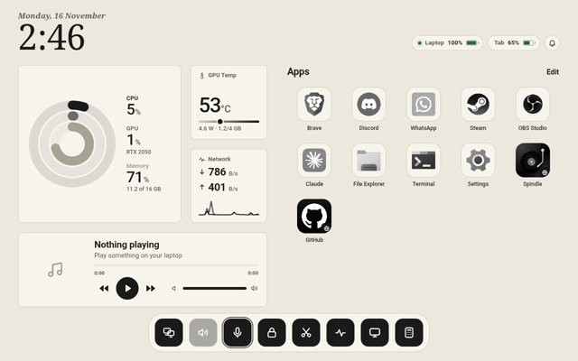
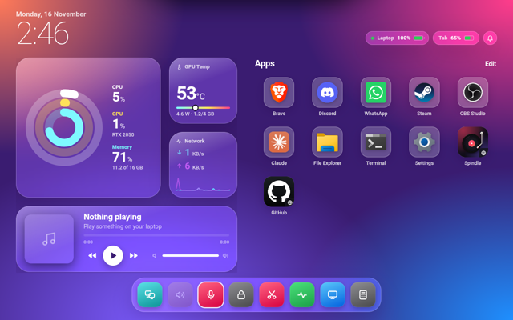
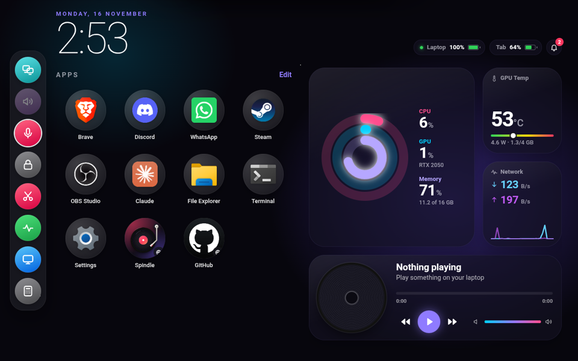
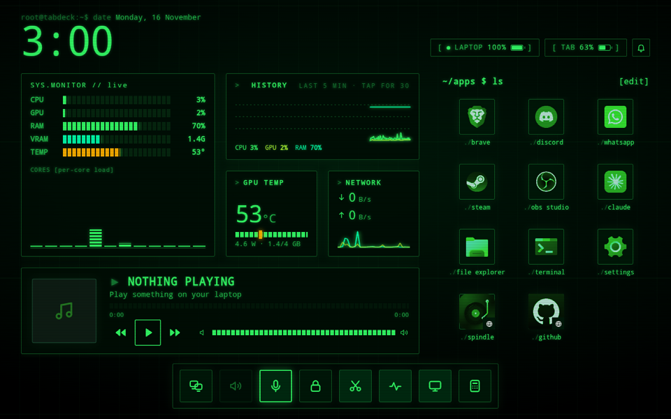

# TabDeck themes

A theme is **one CSS file** that restyles the tablet dashboard. Change colours, fonts, corners, the wallpaper,
rearrange widgets, add overlays: anything CSS can do.

| Default | Daylight | Terminal |
|---|---|---|
|  |  |  |
| **Neon** | **Paper** | **Frosted** |
|  |  |  |

### Not just colours: **Orbit** changes the layout


Same dashboard, different layout: apps and widgets swapped, the dock stands vertically on the left, round app icons,
bigger widgets, and Now Playing becomes a vinyl that spins while music plays. All of it is plain CSS. Read
[`orbit.css`](command-center/themes/orbit.css); every section is commented so you can copy pieces.

The key tricks:
```css
.screen   { grid-template-columns: 1fr 560px; }       /* swap the two columns */
.apps     { order: 1; }  .widgets { order: 2; }
.dock     { left: 22px; top: 50%; bottom: auto; transform: translateY(-50%); flex-direction: column; }
.np.is-playing .np-art { animation: spin 9s linear infinite; }
```

### No rings, all graphs: **Hacker**


The stats widget also contains **bar graphs and a per-core CPU chart** that are hidden by default. Any theme can
switch them on (and the rings off):

```css
.perf .rings, .perf .legend { display: none !important; }
.perf .pbars { display: flex; }                        /* CPU / GPU / RAM / VRAM / TEMP bars + core chart */
.pb .pt i  { background: repeating-linear-gradient(90deg, #33ff66 0 7px, transparent 7px 9px); }   /* LED look */
.cores i   { background: #33ff66; }                    /* one bar per CPU core, height = load */
[data-w="hist"] { display: flex !important; }          /* force the History graphs on */
```
Parts: `.pbars`, `.pb[data-b="cpu|gpu|ram|vram|temp"]` → `.pl` label, `.pt` track, `.pt i` fill, `b` value;
`.cores-h` heading, `.cores i` core bars. See [`hacker.css`](command-center/themes/hacker.css).

## Install a theme
TabDeck settings app → **Themes** → **Upload .css**. It applies instantly. Click any card to switch, and
**Default** to go back. Uploaded themes have a 🗑 button.

## Make your own (5 minutes)
1. Settings app → Themes → **Template** (downloads [`_template.css`](command-center/themes/_template.css)).
2. Change the variables at the top. That alone gets you a new look.
3. Upload it. Re-uploading a theme with the same `@name` updates it.

### The header (shown in the gallery)
```css
/*
 * @name Midnight Blue
 * @author your-github-name
 * @description One line about your theme.
 * @colors #0b1020 #16213e #4f8cff #e94560     <- up to 5 swatches for the gallery card
 */
```

### Variables (the easy way)
| Variable | What it changes |
|---|---|
| `--text` `--dim` `--faint` | main / secondary / hint text |
| `--glass` `--glass-hi` `--hair` | widget background / inner buttons / hairline borders |
| `--accent` (`--blue`) | Edit button, links, active things |
| `--red` `--green` `--cyan` `--orange` `--yellow` `--purple` | status colours |
| `--ring-cpu` `--ring-gpu` `--ring-ram` | the activity rings **and** the History graph lines |
| `--r-widget` | widget corner radius |
| `--wall-base` `--wall-img` | wallpaper colour / image (overrides the one picked in settings) |

### Parts you can target
| Part | Selector |
|---|---|
| Clock, date | `.when .time`, `.when .date` |
| Status pills, battery | `.pill`, `.batt` |
| Widget grid / any widget | `.widgets`, `.w`, `.w-title` |
| Specific widget | `[data-w="perf"]` rings · `"gpu"` · `"net"` · `"media"` Now Playing · `"mic"` · `"hist"` History |
| Rings | `.rings .trk` (track), `.rings .val` (value) |
| Numbers | `.big`, `.legend .k / .v / .s` |
| Now Playing | `.np-art`, `.np-title`, `.np-artist`, `.sbar .trk/.fill` (seek & volume bars), `.np-ctl .pp` |
| History graph | `.hist-svg path`, `#hCpu`, `#hGpu`, `#hRam`, `.hist-legend` |
| Apps | `.apps-head h2`, `.app .tile`, `.app .tile img`, `.app .name` |
| Dock | `.dock`, `.dk`, colours `.g-gray .g-pink .g-green .g-blue .g-indigo .g-orange .g-teal .g-purple` |
| Pop-ups | `.banner` (notifications), `.ask` (Claude Allow/Deny), `.sheet` |

**State hooks:** `html[data-theme="<file-name>"]`, `.np.is-playing`, `.np.has-art`, `.dk.toggle.on`,
`.mic.on`, `.editing .app` (jiggle mode).

### Tips
- Use `!important` when overriding something the dashboard sets per element (tiles, dock buttons, Now Playing button).
- Overlays: `body::after { content:""; position:fixed; inset:0; pointer-events:none; ... }` (see *Terminal*'s scanlines).
- Light themes: also restyle `.app .name`, `.np-artist`, `.np-ctl .pp`, `.banner`, `.ask` (see *Daylight*).
- The tablet is modest: heavy `backdrop-filter` blur on many elements can cost smoothness.

## Rules (why themes are safe to share)
- **CSS only.** Themes can't run code, so a theme can never press buttons, approve Claude prompts or touch your PC.
- `@import` and `http(s)` links are **removed** on upload (TabDeck stays offline). Embed images/fonts as `data:` URIs.
- Max **256 KB**.

## Share yours
Open a pull request adding your file to [`command-center/themes/`](command-center/themes/) with a screenshot.
The best ones ship in the next release.
